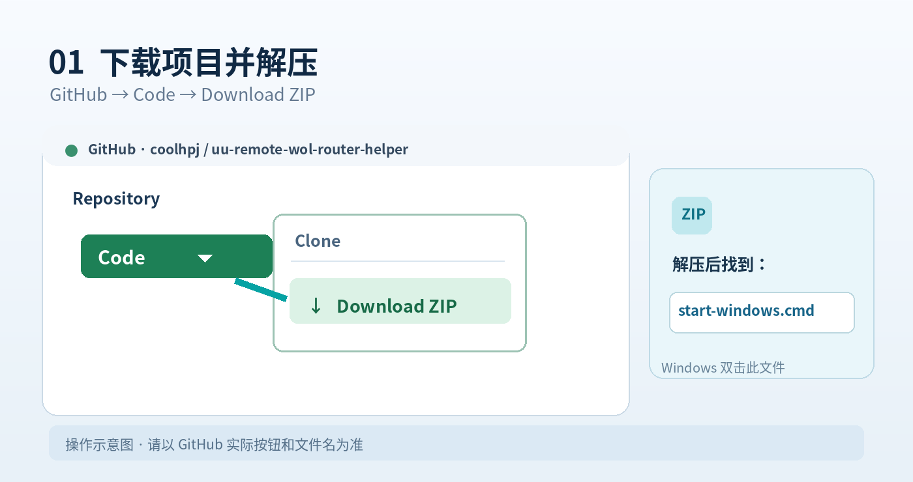
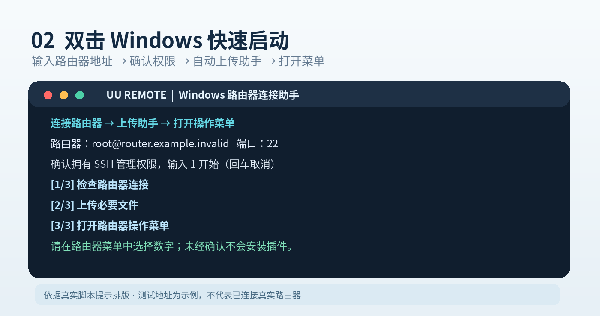
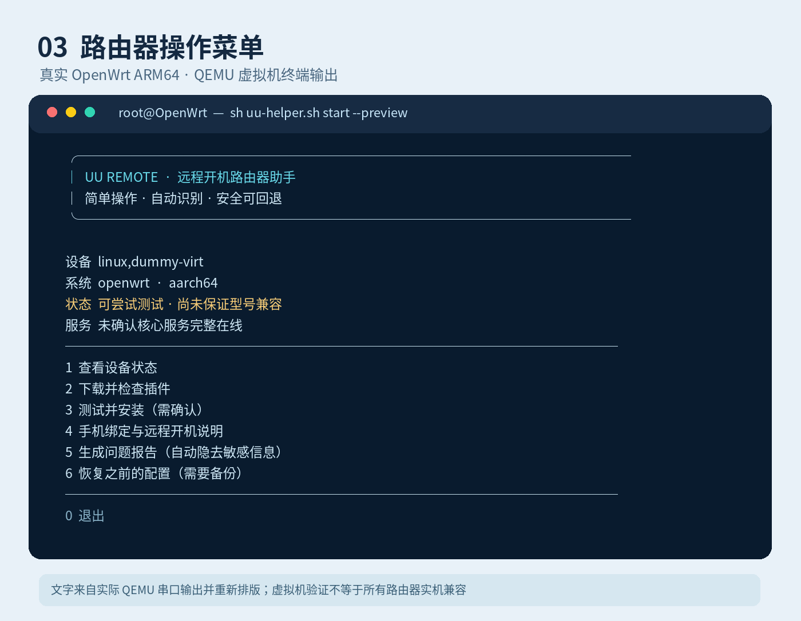
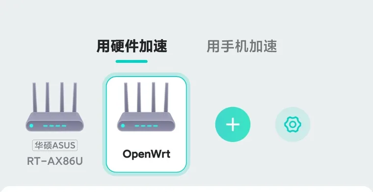

# 网易 UU 远程开机 · 路由器助手


*项目功能概览（设计示意图，不代表任何型号已经通过实际远程唤醒验收）。*

让具备 OpenWrt 等环境的路由器，有机会成为网易 UU 远程开机的辅助设备。**自动识别环境、获取并校验官方插件、引导测试与安装**，不用自己挑选一堆命令。

> 非网易官方项目。**不是所有路由器都能安装**；设备型号和固件须满足条件，手机移动网络实际唤醒成功才算验证通过。

## 新手快速开始（3 步）

**第 1 步｜先让电脑支持唤醒。** Windows 上打开 **UU远程 → 远程开机配置**，按官方向导启用 BIOS（主板固件）与网卡 WOL（局域网唤醒）。电脑优先连接有线网络；可先用局域网设备验证电脑能被唤醒。

**第 2 步｜在 Windows 上打开助手。** 路由器须已通过合法方式启用 SSH（远程管理终端），并且你拥有管理员权限。点击 GitHub 的 **Code → Download ZIP**，解压后双击根目录的 **`start-windows.cmd`（Windows 快速启动）**。输入路由器 IP 地址；工具会自动上传运行所需代码，并进入路由器的数字菜单。首次连接请核对路由器 SSH 指纹，上传和登录可能需要多次输入路由器密码；本项目不会保存密码。

程序只把助手文件放入路由器的 `/tmp` 临时目录，**不会因为启动 Windows 工具就安装 UU 插件或修改系统启动项**。安装等操作仍要在菜单里明确确认。

<details>
<summary>查看图文操作示意：下载项目和 Windows 启动</summary>





**图片说明：** 图 1 为下载操作示意，不是 GitHub 页面截图；图 2 根据本项目 Windows 脚本提示排版，`router.example.invalid` 为测试地址，图中没有连接真实设备。

</details>

不使用 Windows，或者电脑缺少 OpenSSH（安全远程终端工具）？可按 [手动上传教程](docs/MANUAL-SETUP.md) 将项目目录上传到路由器，再执行：

```sh
cd /tmp/uu-remote-wol-router-helper
sh uu-helper.sh start
```

程序自动识别系统、处理器和适配状态，显示可用数字选项；你不必自己挑 `asuswrt`、`openwrt` 或 `xiaoqiang` 的脚本。**未验证的机型不会自动获得安装许可。**

<details>
<summary>查看 OpenWrt 操作菜单示例（来自真实 QEMU 虚拟机日志）</summary>



这张图使用 [QEMU ARM64 Lab 虚拟机测试](https://github.com/coolhpj/uu-remote-wol-router-helper/actions/runs/38160517622) 的真实串口输出文字排版，**不是直接截屏**。虚拟设备 `linux,dummy-virt`、系统 `openwrt / aarch64` 及菜单文字都来自当次日志；其他路由器的菜单可能不同，也不代表 Lenovo Y1 / MIPS 已通过远程唤醒。

</details>

> 已在网易 UU「合作款路由器」中直接支持的设备，优先走官方方案，不必用本工具。MIPS（处理器架构）机型如 Lenovo Y1 目前仍是实验性支持，菜单禁止持久安装。任何临时运行或持久安装均需要确认，绝不会因进入菜单就自动修改路由器。

**第 3 步｜绑定网易账号，验证真正远程开机。** 手机先连接家中 Wi-Fi，打开 **网易 UU 主机加速器 → 路由器加速 → 合作款路由器**，按提示添加路由器；确保与 Windows **UU远程** 使用正确的账号关系。在 Windows UU远程里刷新辅助设备、逐台配置电脑。最后关闭手机 Wi-Fi，**仅用移动数据**尝试唤醒关机的电脑。

**真正唤醒成功才算通过**，插件启动或连上云端不代表成功。

需要特殊机型说明、传统手动命令或故障排查？查看 [高级操作教程](docs/MANUAL-SETUP.md) 和 [设备兼容矩阵](docs/COMPATIBILITY.md)。

---

## 你应该看到什么？

完整链路应该是：

```text
手机移动数据
    ↓
网易 UU 云端
    ↓
家里常在线的辅助设备
    ↓
局域网 Magic Packet
    ↓
关机 PC 开机
```

只满足下面这些情况都还不能算最终成功：

- `uuplugin` 进程存在；
- 路由器能联网；
- UU主机加速能看到路由器；
- 局域网里手工 WOL 能开机。

最终验收必须是：**手机关闭 Wi‑Fi，仅使用移动数据，把真正关机的 PC 唤醒。**

## 已验证设备 / 环境

| Router / Environment | Platform | Remote WOL | 说明 |
|---|---|---:|---|
| Redmi AX6000 / RB06 | XiaoQiang / OpenWrt-derived | ✅ | 已完成真实冷启动、UU 云连接、移动数据 Remote WOL |
| ASUS RT-AX86U | ASUSWRT / Merlin-KoolShare | ✅ | 官方/model-specific 路径；本项目默认不覆盖官方集成 |
| iStoreOS x86_64 样本 | Generic OpenWrt | ✅ | 已完成持久安装、reboot、自启动、Remote WOL、rollback 与再次 reboot |
| 其它 Generic OpenWrt | OpenWrt | 待逐台验证 | 架构相同不等于自动兼容 |

> `✅` 只用于已经有真实移动数据远程开机证据的设备/样本，不因为插件能启动就标记兼容。

完整兼容矩阵：[`docs/COMPATIBILITY.md`](docs/COMPATIBILITY.md)

下图是实测环境中 UU主机加速识别 ASUS RT-AX86U 与 OpenWrt 辅助设备的脱敏截图：



## 最常见的几个问题

### 路由器后台像运营商光猫，没有插件市场，也没有 SSH/root

这类设备通常**不适合直接使用本项目**。不要为了 UU远程去动 TR069、VLAN、运营商 WAN 等配置。

优先使用 Android / 常开电脑作为 UU 辅助设备，或者在光猫后面增加一台真正支持 UU/OpenWrt 的路由器。

### 路由器已经被 UU主机加速识别，但 UU远程仍提示没有辅助设备

先检查：

- UU主机加速与 UU远程是否处于正确的同账号关系；
- 当前 PC 是否单独完成过一次远程开机配置；
- 路由器上的 UU 是否真正建立云连接，而不是只有进程存在。

### 同一个账号下有多台 PC，为什么只有一台能开？

每台 PC 都要分别完成自己的 WOL / 远程开机配置，不会因为同账号自动继承。

### `diagnose` 显示 `platform: unknown`

不要拿其它型号脚本硬套。运行：

```sh
sh uu-helper.sh collect-info
```

提交脱敏报告后再适配。

## 安全边界

本项目：

- **不提供**破解、漏洞利用或绕过设备安全限制取得 SSH/root 的教程；
- **不提交**网易 `uuplugin`、`xuplugin-guardian`、`xtables-nft-multi` 等闭源二进制；
- 运行时只从网易官方通道获取插件，并进行完整性校验；
- 未知设备默认只允许 `Detect → Collect → Redact → Report`，不会自动猜型号安装；
- Generic OpenWrt 的一个样本通过，不代表所有 OpenWrt 自动兼容。

安全说明：[`SECURITY.md`](SECURITY.md)

SSH/root 边界：[`docs/SSH-ACCESS.md`](docs/SSH-ACCESS.md)

## 想看技术细节？

README 只保留普通用户真正需要看的内容。实现、实验和平台差异放在下面：

- 完整设备矩阵：[`docs/COMPATIBILITY.md`](docs/COMPATIBILITY.md)
- Generic OpenWrt / iStoreOS：[`docs/OPENWRT.md`](docs/OPENWRT.md)
- XiaoQiang / Redmi AX6000：[`docs/XIAOQIANG.md`](docs/XIAOQIANG.md)
- ASUSWRT：[`docs/ASUSWRT.md`](docs/ASUSWRT.md)
- 多辅助设备行为：[`docs/MULTI-AUX-DEVICE.md`](docs/MULTI-AUX-DEVICE.md)
- 贡献新设备：[`CONTRIBUTING.md`](CONTRIBUTING.md)

## 项目原则

本项目来自真实设备排障，并大量使用 AI 辅助分析和代码生成。因此维护规则很简单：

> **Verified（已验证）必须来自真实硬件证据，不能来自 AI 推测。**

任何 AI 生成代码进入可写入路由器的路径前，都必须有明确安全门、回滚设计、自动测试和真实设备证据。

## License / 许可证与署名

本项目使用 [MIT License](LICENSE)。

Copyright (c) 2026 **coolhpj and contributors**.

MIT 许可证允许使用、复制、修改、合并、发布、分发、再许可和商业使用；但在重新发布本项目代码或其 substantial portions（主要部分）时，**必须保留原版权声明和 MIT 许可文本**。

如果你基于本项目制作衍生版本，欢迎同时注明原始项目来源，方便用户找到上游更新与兼容性说明：

<https://github.com/coolhpj/uu-remote-wol-router-helper>

> 注：回链到原仓库是推荐做法；MIT 许可证的强制要求是保留版权声明和许可文本，不额外增加限制。

