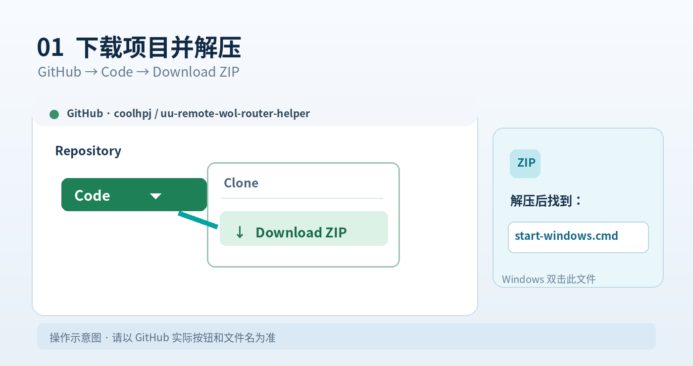
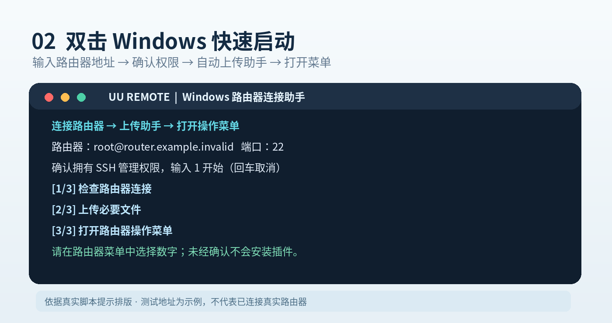
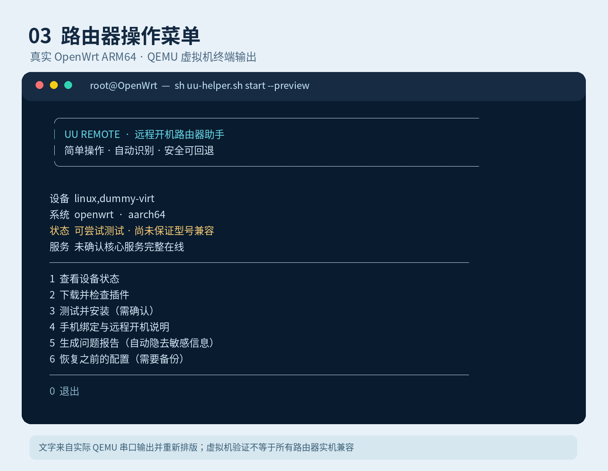
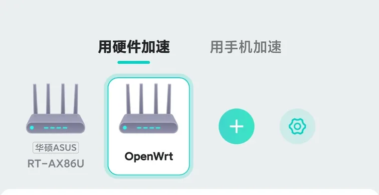

# 网易 UU 远程开机路由器助手｜OpenWrt 安装、UU 辅助开机


*项目功能概览（设计示意图，不代表任何型号已经通过实际远程唤醒验收）。*

## 选哪个版本？

- **路由器版**：OpenWrt、iStoreOS、华硕等，见下方[平台下载](#按平台下载预览测试版尚非稳定版)。
- **Docker 路由器模式**：在 Linux 或部分 NAS 上运行路由器插件，见 [NAS 安装教程](docs/NAS.md)。
- **NAS 独立辅助设备版**：普通 NAS 通过 Docker 运行独立 WOL-only 辅助设备，见 [源码测试版与安装方法](docs/NAS-WOL-ONLY-BETA.md)。

这几种方式的设备身份不同，**不要混用数据卷或绑定信息**。

## 🐳 Docker 路由器模式（测试版）

**适用环境：** Debian、Ubuntu、iStoreOS、飞牛 OS 等安装了 Docker 的常开 Linux 主机。优先 x86_64；ARM64 目前仅完成自动构建测试。**Docker 代码仍在 [PR #16 独立实验分支](https://github.com/coolhpj/uu-remote-wol-router-helper/pull/16)，尚未合并到 `main`，也未发布稳定镜像。**

**一条命令部署：** 预先安装 **Git、curl、Docker Engine 和 Docker Compose**，确认当前用户可正常使用 Docker，再在 Linux 终端复制下面一整行：

```sh
curl -fsSLo uu-docker-start.sh https://raw.githubusercontent.com/coolhpj/uu-remote-wol-router-helper/feat/docker-experimental/docker/quickstart.sh && sh uu-docker-start.sh
```

启动器会下载实验分支、检查环境、构建并启动容器，不会自动安装 Docker、改动宿主机防火墙、开启特权容器或删除身份卷。建议先[阅读一键启动器源码](https://github.com/coolhpj/uu-remote-wol-router-helper/blob/feat/docker-experimental/docker/quickstart.sh)。**启动成功不代表远程开机成功**；还需要在网易 UU 手机端绑定，并关闭 Wi-Fi、仅用移动数据真实测试唤醒已关机的电脑。

[Docker 四步安装、绑定、更新和卸载教程](https://github.com/coolhpj/uu-remote-wol-router-helper/blob/feat/docker-experimental/docker/README.md) · [实机测试反馈 Issue #15](https://github.com/coolhpj/uu-remote-wol-router-helper/issues/15)

**另一个独立研发方向（尚不可安装）：** [Draft PR #19：UU远程辅助设备 WoL-only 实验](https://github.com/coolhpj/uu-remote-wol-router-helper/pull/19) 研究让常开的路由器、Linux 主机或 NAS 使用 **UU远程辅助设备身份**接收唤醒指令，而不是复用上述 Docker 的官方路由器 `uuplugin` 身份。当前仅完成 GitHub Actions 的模拟扫码、注册/认证消息校验及本机 UDP 测试，**尚未完成真实网易 UU 账号绑定、云端指令或手机移动网络开机验证；不提供该模式的安装命令或可用镜像**。PR #16 与 PR #19 是两条互不混淆的实验路线。


## 🗄️ NAS 专区｜QNAP、群晖、飞牛、极空间 Docker 测试版

**[下载 NAS / Linux Docker 测试版源码 ZIP（固定提交）](https://github.com/coolhpj/uu-remote-wol-router-helper/archive/28a25816101b68e8fc269109942c2f465f0e5b72.zip)** · **[NAS 完整安装、绑定、停止、升级、卸载及测试反馈教程](docs/NAS.md)**

适合具有 Docker Engine 和 `docker compose` 的 NAS/常开 Linux 主机；`x86_64` 优先、ARM64 为候选。该 ZIP 含 `Dockerfile`、`compose.yaml`、NAS 只读环境检查脚本与开源安装代码，**不是预编译 Docker 镜像**；不捆绑网易闭源程序。首次构建及运行需要联网。系统自带的 NAS 图形容器管理器不一定支持源码构建，推荐用终端 / SSH 操作。

**先在下载 ZIP 解压后的仓库根目录检查：**

~~~sh
sh scripts/nas-preflight.sh
docker compose config --quiet
~~~

检查通过并确认 NAS 上没有冲突的 UU 设备身份或端口后，才启动：

~~~sh
docker compose build
docker compose up -d --no-build
docker compose ps
~~~

测试容器使用 **host 网络**，虽然不采用 `privileged`、`NET_ADMIN` 或宿主 `docker.sock`，但**不是完全隔离网络**。必须在自有设备上知情试用。手机关闭 Wi-Fi、只用移动数据真正唤醒关机 PC，才算远程唤醒成功。停止用 `docker compose stop`；退出实验用 `docker compose down`，默认保留身份卷；**不要运行 `down -v` 误删绑定数据**。请把脱敏成功/失败记录提交到 [Issue #15](https://github.com/coolhpj/uu-remote-wol-router-helper/issues/15)。

**注意：** 这是 PR #16 的 Docker 路由器插件身份测试版，不是 NAS 独立辅助设备版。普通 NAS 还可查看下面的 WOL-only 源码预览；两个版本不要混用身份文件。

## 🖥️ NAS 独立辅助设备版（WOL-only 源码测试版）

适合装有 Docker 的 QNAP、群晖、飞牛和极空间等普通 NAS。**不要求 NAS 充当主路由器。**

[下载源码 ZIP](https://github.com/coolhpj/uu-remote-wol-router-helper/archive/66707aeb20f0021b45ac5f95d4aec243197b4c41.zip) · [简单安装与测试教程](docs/NAS-WOL-ONLY-BETA.md) · [提交测试结果（Issue #23）](https://github.com/coolhpj/uu-remote-wol-router-helper/issues/23)

GitHub 已通过 Docker 构建和模拟局域网唤醒测试，**但这个版本尚未通过真实网易 UU 手机远程开机验收**。当前优先邀请 x86_64 NAS 用户自愿试用；ARM64 暂未验证。

本模式使用独立 GPL-3.0-or-later 客户端，与上面的 Docker 路由器插件版本不同。源码开放，暂无正式稳定镜像。

**开发说明：** 本项目部分代码、测试和文档由 **ChatGPT（OpenAI GPT-6）协助开发**，维护者审核发布。非网易官方项目。

---

想用**网易 UU 远程开机**，让家里的路由器充当**UU 辅助开机 / 网易 UU 远程辅助设备**，但找不到适合自己固件的**路由器插件**或 **OpenWrt 安装**方法？本项目提供开源的检测、官方插件下载校验和分平台安装引导，帮助你判断路由器是否适合辅助唤醒关机电脑。**不是网易官方插件，也不保证所有路由器可安装或长期在线。**

**从哪里开始？** [下载五平台预览测试包](https://github.com/coolhpj/uu-remote-wol-router-helper/releases/tag/v0.1.0-beta.2) · [查看支持的设备和固件](docs/COMPATIBILITY.md) · [OpenWrt / iStoreOS 使用说明](docs/OPENWRT.md)

> 非网易官方项目。**不是所有路由器都能安装**；设备型号和固件须满足条件，手机移动网络实际唤醒成功才算验证通过。

## 按平台下载（预览测试版，尚非稳定版）

**[点击这里下载 v0.1.0-beta.2 五平台测试版（GitHub Releases 版本发布页）](https://github.com/coolhpj/uu-remote-wol-router-helper/releases/tag/v0.1.0-beta.2)**。已提供五个独立的 ZIP（压缩包）及 SHA256（文件校验清单），无需进入自动构建记录中寻找附件。此版包含通用 OpenWrt 服务停止时防止误停其他 UU 守护进程的安全修复。**当前仍为预览测试版，不要把同架构所有型号当成已验证兼容；MIPS 通用永久安装依然禁止。**

| 包名 | 适用环境 | 安装验证范围 |
| --- | --- | --- |
| `uu-helper-openwrt-x86_64.zip` | OpenWrt / iStoreOS x86_64 | 已验证的仅为当前 iStoreOS x86_64 实机样本 |
| `uu-helper-openwrt-aarch64.zip` | OpenWrt ARM64 | 候选测试包，不保证任意型号可安装 |
| `uu-helper-openwrt-mipsel-y1-beta.zip` | Lenovo Y1 / Newifi mini R6830 | **仅限 Y1 的实验版**；实机已安装并观察到重启后服务运行，但发现旧设备绑定跨重启失效，**暂不适合无人值守使用** |
| `uu-helper-xiaoqiang-aarch64.zip` | 小米 / 红米 XiaoQiang ARM64 固件 | 已验证参考型号为 Redmi AX6000；其他型号仍需验证 |
| `uu-helper-asuswrt.zip` | 华硕 ASUSWRT / 梅林 | **官方集成优先，只提供检测辅助，不覆盖原厂 UU** |

解压后 Windows 用户可使用 `start-windows.cmd` 上传助手，其他用户可按手动教程上传并运行 `sh uu-helper.sh start`。压缩包带有设备平台与处理器限制，选错包会拒绝安装相关操作；全部只包含项目开源脚本，**不附带网易闭源插件**，使用时才通过官方接口下载并校验。

开发者可运行 `python3 scripts/build-platform-packages.py --output dist` 在本地生成五个确定性 ZIP 和 `SHA256SUMS.txt`（校验清单）；[自动打包记录](https://github.com/coolhpj/uu-remote-wol-router-helper/actions/workflows/platform-packages.yml) 仅供排障和开发者核对。**正式稳定版**仍须等待对应设备完成实机验收。

## 新手快速开始（3 步）

**第 1 步｜设置电脑唤醒。** 打开 Windows **UU远程**，找到当前版本的远程开机相关设置或协助向导（部分版本显示 **「允许通过远程开机启动」→「开始协助」**，不一定存在名为「远程开机配置」的菜单），按向导提示开启主板和网卡的 WOL（网络唤醒）。建议电脑使用网线，并先确认局域网内能唤醒。

**第 2 步｜启动路由器助手。** 路由器需要已开启 SSH（远程登录），并能用管理员账号登录。优先从上面的 **Releases（版本发布页）** 下载与你的路由器系统、架构匹配的 ZIP（压缩包），解压后双击 **`start-windows.cmd`**，输入路由器地址。助手会自动上传文件，打开数字菜单。开发者仍可用 GitHub 的 **Code → Download ZIP（下载完整源码）** 获取全部源文件。

首次连接请核对 SSH 指纹；可能需要输入几次路由器密码。**这一步只启动助手，不会自动安装插件。**

<details>
<summary>看图操作：下载与 Windows 启动</summary>





*两张均为操作示意图；图中的 `router.example.invalid` 是测试地址。*

</details>

**第 3 步｜先运行插件，再绑定和远程开机。** 按数字菜单的设备提示完成适用的运行步骤；**只有路由器上的 UU 插件正在运行时**，才用连接该路由器 Wi-Fi 的手机打开 **网易 UU 主机加速器 → 路由器加速 → 合作款路由器**，查找并添加路由器。在电脑 **UU远程** 中刷新、选择该辅助设备并完成本机配置，确认账号对应。最后关闭手机 Wi-Fi，使用**移动数据**尝试唤醒电脑。仅下载插件或出现云连接，不等于完成了手机绑定。

**只有电脑真正被远程唤醒才算成功**，插件在线不代表远程开机成功。

### 其他使用方式与注意事项

非 Windows 用户或快速启动失败，可按 [手动上传教程](docs/MANUAL-SETUP.md) 上传文件后运行：

```sh
cd /tmp/uu-remote-wol-router-helper
sh uu-helper.sh start
```

助手自动识别设备并显示可用菜单；是否能安装仍取决于型号和固件。**网易 UU 已原生支持的路由器优先使用官方方案。** Lenovo Y1 已在临时运行阶段完成手机移动数据唤醒，专用实验性服务也已成功安装并在真实重启后显示运行；**但 2026-10-14 测试者确认旧设备绑定跨重启失效、需要重新绑定，因此当前不适合长期无人值守使用**，仍需安全修复与实机复测。**通用 MIPS（处理器架构）持久安装依然禁止**；更多请查看 [Lenovo Y1 实验版说明](docs/OPENWRT.md#lenovo-y1自愿试用的持久启动方案尚待真机验收) 和 [实机反馈与故障跟踪](https://github.com/coolhpj/uu-remote-wol-router-helper/issues/1)。

<details>
<summary>查看路由器菜单示例</summary>



*根据 [QEMU ARM64 虚拟机测试日志](https://github.com/coolhpj/uu-remote-wol-router-helper/actions/runs/38160517622) 排版，并非真实屏幕截图；其他设备菜单可能不同。*

</details>

更多信息：[高级操作教程](docs/MANUAL-SETUP.md) · [设备兼容矩阵](docs/COMPATIBILITY.md)。

---

## 你应该看到什么？

完整链路应该是：

```text
手机移动数据
    ↓
网易 UU 云端
    ↓
家里常在线的辅助设备
    ↓
局域网 Magic Packet
    ↓
关机 PC 开机
```

只满足下面这些情况都还不能算最终成功：

- `uuplugin` 进程存在；
- 路由器能联网；
- UU主机加速能看到路由器；
- 局域网里手工 WOL 能开机。

最终验收必须是：**手机关闭 Wi‑Fi，仅使用移动数据，把真正关机的 PC 唤醒。**

## 实机验证结果与设备状态

| Router / Environment | Platform | Remote WOL | 说明 |
|---|---|---:|---|
| Redmi AX6000 / RB06 | XiaoQiang / OpenWrt-derived | ✅ | 已完成真实冷启动、UU 云连接、移动数据 Remote WOL |
| ASUS RT-AX86U | ASUSWRT / Merlin-KoolShare | ✅ | 官方/model-specific 路径；本项目默认不覆盖官方集成 |
| iStoreOS x86_64 样本 | Generic OpenWrt | ✅ | 已完成持久安装、reboot、自启动、Remote WOL、rollback 与再次 reboot |
| Lenovo Y1 / Newifi mini R6830 | OpenWrt / MIPS | ✅（仅临时运行） | 2026-10-12 实机手机流量唤醒成功；专用实验版安装并重启后服务运行已观察，但**跨重启旧绑定失效**；正式稳定安装未开放 |
| 其它 Generic OpenWrt | OpenWrt | 待逐台验证 | 架构相同不等于自动兼容 |

> `✅` 仅表示该设备/样本已有真实移动数据远程开机证据。**临时运行成功不等于已完成永久安装或重启回滚验收**；Lenovo Y1 仍是实验性设备，不标记为完整 Verified（已验证）。

完整兼容矩阵：[`docs/COMPATIBILITY.md`](docs/COMPATIBILITY.md)

下图是实测环境中 UU主机加速识别 ASUS RT-AX86U 与 OpenWrt 辅助设备的脱敏截图：



## 最常见的几个问题

### 网易 UU 远程开机一定要装路由器插件吗？

不一定。路由器已提供网易 UU 官方远程开机功能时，优先用官方入口；如果没有，先看[兼容设备清单](docs/COMPATIBILITY.md)，不要因为使用 OpenWrt 就直接安装其他型号的包。电脑仍需事先配置 WOL（网络唤醒），在手机移动数据下完成真实开机测试。

### UU 辅助开机和网易 UU 远程控制有什么区别？

**UU 辅助开机**由局域网里持续在线的辅助设备发送网络唤醒信号，让关机电脑开机；**网易 UU 远程控制**负责电脑开机后的连接和操作。本项目只帮助兼容路由器承担前一种辅助角色，并不替代网易 UU 远程客户端。

### OpenWrt 安装网易 UU 路由器插件后，还需要绑定吗？

需要。先确认路由器上的官方 UU 插件正常运行，再进入**网易 UU 主机加速器 → 路由器加速 → 合作款路由器**添加辅助设备，并在电脑端的 UU 远程开机设置完成关联。**安装成功或看到进程，并不等于手机远程开机已经成功。**

### Lenovo Y1 重启后需要重新绑定 UU 辅助设备怎么办？

这已是[社区实机报告的未修复问题](https://github.com/coolhpj/uu-remote-wol-router-helper/issues/1#issuecomment-6164268516)：当前实验版可能在路由器重启后使原设备显示离线。**不要把反复重新绑定当成稳定解决方法**，也不要自行把整个插件写进空间有限的闪存；我们正在评估内置压缩包或 U 盘持久存储方案，**两者都尚未证明能够保存原绑定身份**。

### 路由器后台像运营商光猫，没有插件市场，也没有 SSH/root

这类设备通常**不适合直接使用本项目**。不要为了 UU远程去动 TR069、VLAN、运营商 WAN 等配置。

优先使用 Android / 常开电脑作为 UU 辅助设备，或者在光猫后面增加一台真正支持 UU/OpenWrt 的路由器。

### 路由器已经被 UU主机加速识别，但 UU远程仍提示没有辅助设备

先检查：

- UU主机加速与 UU远程是否处于正确的同账号关系；
- 当前 PC 是否单独完成过一次远程开机配置；
- 是否先在 **网易 UU 主机加速器 → 路由器加速 → 合作款路由器** 添加了**正在运行 UU 插件**的路由器；
- 路由器上的 UU 是否真正建立云连接，而不是只有进程存在。

### 同一个账号下有多台 PC，为什么只有一台能开？

每台 PC 都要分别完成自己的 WOL / 远程开机配置，不会因为同账号自动继承。

### `diagnose` 显示 `platform: unknown`

不要拿其它型号脚本硬套。运行：

```sh
sh uu-helper.sh collect-info
```

提交脱敏报告后再适配。

## 安全边界

本项目：

- **不提供**破解、漏洞利用或绕过设备安全限制取得 SSH/root 的教程；
- **不提交**网易 `uuplugin`、`xuplugin-guardian`、`xtables-nft-multi` 等闭源二进制；
- 运行时只从网易官方通道获取插件，并进行完整性校验；
- 未知设备默认只允许 `Detect → Collect → Redact → Report`，不会自动猜型号安装；
- Generic OpenWrt 的一个样本通过，不代表所有 OpenWrt 自动兼容。

安全说明：[`SECURITY.md`](SECURITY.md)

SSH/root 边界：[`docs/SSH-ACCESS.md`](docs/SSH-ACCESS.md)

## 想看技术细节？

README 只保留普通用户真正需要看的内容。实现、实验和平台差异放在下面：

- 完整设备矩阵：[`docs/COMPATIBILITY.md`](docs/COMPATIBILITY.md)
- Generic OpenWrt / iStoreOS：[`docs/OPENWRT.md`](docs/OPENWRT.md)
- XiaoQiang / Redmi AX6000：[`docs/XIAOQIANG.md`](docs/XIAOQIANG.md)
- ASUSWRT：[`docs/ASUSWRT.md`](docs/ASUSWRT.md)
- 多辅助设备行为：[`docs/MULTI-AUX-DEVICE.md`](docs/MULTI-AUX-DEVICE.md)
- 贡献新设备：[`CONTRIBUTING.md`](CONTRIBUTING.md)

## 项目原则

本项目来自真实设备排障，并大量使用 AI 辅助分析和代码生成。因此维护规则很简单：

> **Verified（已验证）必须来自真实硬件证据，不能来自 AI 推测。**

任何 AI 生成代码进入可写入路由器的路径前，都必须有明确安全门、回滚设计、自动测试和真实设备证据。

## License / 许可证与署名

本项目使用 [MIT License](LICENSE)。

Copyright (c) 2026 **coolhpj and contributors**.

MIT 许可证允许使用、复制、修改、合并、发布、分发、再许可和商业使用；但在重新发布本项目代码或其 substantial portions（主要部分）时，**必须保留原版权声明和 MIT 许可文本**。

如果你基于本项目制作衍生版本，欢迎同时注明原始项目来源，方便用户找到上游更新与兼容性说明：

<https://github.com/coolhpj/uu-remote-wol-router-helper>

> 注：回链到原仓库是推荐做法；MIT 许可证的强制要求是保留版权声明和许可文本，不额外增加限制。

